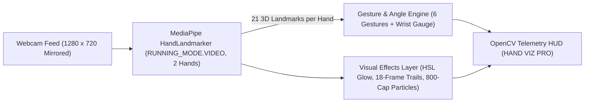

# HandViz Pro — Real-Time Hand Tracking Visualization

**Dual-Hand Computer Vision Telemetry, Gesture Classifier & Interactive HUD**


HandViz Pro is a real-time dual-hand computer vision visualizer built with **MediaPipe `HandLandmarker`**, **OpenCV**, and **NumPy**. It tracks up to two hands from a mirrored `1280 x 720` webcam feed and renders an interactive neon telemetry HUD featuring per-finger HSL glow skeletons, fingertip motion trails, particle physics, two-hand distance bridging, wrist orientation gauges, and 6-class gesture recognition.

> **Interactive Desktop Window:** Because `handviz_pro.py` requires a live webcam stream and renders via OpenCV GUI (`cv2.imshow`), no static screenshots are fabricated here—run `./run.sh` locally to launch the live HUD.

---

## Vision & HUD Pipeline



---

## Core Features

- **Dual-Hand 21-Landmark Tracking**: Runs MediaPipe `HandLandmarker` in `RUNNING_MODE.VIDEO` for smooth, low-latency tracking across left and right hands simultaneously.
- **Per-Finger HSL Glow & Inter-Hand Webs**: Renders per-finger HSL gradient glow skeletons, cross-fingertip web overlays, and dynamic two-hand wrist/fingertip bridges.
- **Trails & Particle Physics**: Tracks **18-frame** fingertip motion trails paired with an **800-particle** emitter system (`gravity = 0.06`).
- **Telemetry Panels & Wrist Gauge**: Live HUD displaying `HAND VIZ PRO` status, per-finger `UP` / dash indicators, and a real-time wrist angle orientation gauge.
- **One-Click Bootstrap Launcher (`run.sh`)**: Automatically creates a Python virtual environment, installs dependencies, and downloads `hand_landmarker.task` (~9 MB) if missing.

---

## Recognized Gestures

| Gesture | Hand State |
| :--- | :--- |
| `FIST` | All fingers curled |
| `OPEN HAND` | All five digits extended |
| `PEACE` | Index + middle extended |
| `POINTING` | Index extended alone |
| `PINKY` | Little finger extended |
| `THUMBS UP` | Thumb extended upward |

---

## Interactive Keyboard Controls

| Key | Action |
| :---: | :--- |
| `Q` | Quit application |
| `D` | Toggle Dark / Light background |
| `P` | Toggle Particle physics emitter |
| `G` | Toggle animated HUD grid |
| `M` | Toggle two-hand fingertip distance measurement |
| `H` | Toggle on-screen help overlay |

---

## Project Structure

```text
hand-tracking-visualization/
├── handviz_pro.py                       # Main MediaPipe + OpenCV HUD & gesture engine
├── run.sh                               # Auto-venv setup & launcher script
├── hand_landmarker.task                 # Pre-bundled MediaPipe HandLandmarker model (~7.8 MB)
└── README.md
```

---

## Local Setup

### Prerequisites

- Python 3.9+
- Webcam / integrated camera

### Quick Launch

```bash
git clone https://github.com/IFTI-KAR/hand-tracking-visualization.git
cd hand-tracking-visualization

# Make launcher executable (if needed) and run
chmod +x run.sh
./run.sh
```

Or run manually inside your own Python environment:

```bash
pip install opencv-python mediapipe numpy
python3 handviz_pro.py
```
